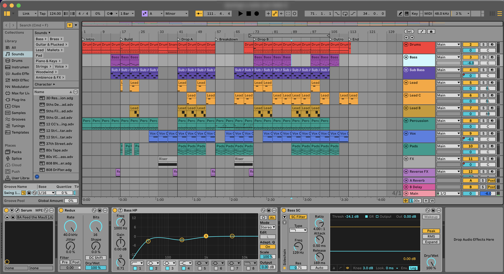

[](https://github.com/gpulga/ableton-dj-mcp/actions/workflows/ci.yml)
[](https://github.com/gpulga/ableton-dj-mcp/releases/latest)
[](./LICENSE)

**An AI studio partner for DJs and electronic music producers.** Describe the
idea, and Claude builds it in your open Ableton Live set: grooves, basslines,
sounds from your own sample libraries, filter sweeps, full arrangements. You
stay in the creative seat.

Music is the most complete way people share something with each other. This tool
exists to help more of it get made. [Read the vision →](./docs/Vision.md)

## Install

Paste this into Claude Code:

```
Install Ableton DJ MCP from https://github.com/gpulga/ableton-dj-mcp and connect
it to this coding agent, following docs/Setup.md. Show me the setup plan for
approval, then verify the installation.
```

The agent does the terminal part. You do two clicks inside Live when it asks.

<details>
<summary>Manual install, Claude Desktop, other clients</summary>

```bash
git clone https://github.com/gpulga/ableton-dj-mcp.git
cd ableton-dj-mcp
npm run setup
```

`setup` installs the Live device and bridge, then prints the exact command to
connect your AI client. No `npm install` or build step.

**Claude Desktop without a terminal:** grab the `.zip` and `.mcpb` from the
[latest release](https://github.com/gpulga/ableton-dj-mcp/releases/latest) and
follow
[these steps](./docs/Setup.md#quick-install-without-a-terminal-claude-desktop).
Cursor and other MCP clients work too: see [Setup](./docs/Setup.md).

</details>

**Requires** Ableton Live 12.3+ with Max for Live (12.4+ for sample loading),
Node.js 24+, macOS or Windows.

## Make music

Start any session with **"connect to ableton"**, then just ask:

> "Set the tempo to 124 and write a rolling 16th-note bassline in A minor, 8
> bars, single octave."

> "Find a 124 BPM bass loop in F minor in my sample libraries and load it on a
> new track."

> "Turn the groove in this top loop into MIDI and put the kick on a Drum Rack."

> "Sweep the filter from 200 Hz to 8 kHz across the build, then read back what
> Live shows."

> "Build an intro, an 8-bar reveal, a breakdown and a drop from these clips."

Cmd+Z undoes one AI action at a time.



## What it can do

| Area            | Highlights                                                                                                         |
| --------------- | ------------------------------------------------------------------------------------------------------------------ |
| **Write**       | MIDI in bar\|beat notation, transform expressions (`velocity += rand(-5, 5)`), Euclidean and named rhythms         |
| **Sound**       | Native devices and racks by name, presets by browser URI, samples into Simpler and drum pads, params in real units |
| **Your sounds** | Search your own sample libraries (Live's Places) by name, with BPM and key read from file names                    |
| **Rework**      | Turn an audio loop into MIDI (drums, melody, harmony), a Simpler, or a sliced Drum Rack                            |
| **Automate**    | Clip envelopes in Hz, dB and %, six curve shapes, recipes for sweeps, fades, dub throws and washouts               |
| **Arrange**     | Session and Arrangement, scenes, locators, duplicate to the timeline, with warnings when a write cuts another clip |
| **Perform**     | Play, stop, loop, fire scenes and clips, record, capture MIDI, undo and redo                                       |
| **Know-how**    | Genre guides for house, tech house, indie dance, melodic techno, afro house, techno, psytrance, loaded on demand   |

25 tools, all prefixed `adj-`. Full parameters:
[Tools Reference](./docs/Tools-Reference.md).

## How it works

```
Claude ──stdio──▶ portal ──HTTP :3350──▶ Max for Live device ──▶ Live API
                                         Python bridge (UDP) ──▶ browser, automation, conversions
```

A Max for Live device on any track runs the MCP server. A small portal connects
your AI client to it. A Python remote script reaches what Max can't: the
browser, clip envelopes, Live's audio conversions and undo history.
[Architecture →](./docs/contributing/Architecture.md)

## Docs

[Setup](./docs/Setup.md) · [Tools](./docs/Tools-Reference.md) ·
[Notation](./docs/specs/BarBeat-Spec.md) · [Vision](./docs/Vision.md) ·
[Roadmap](./docs/Roadmap.md) · [Inspirations](./docs/Inspirations.md) ·
[Contributing](./CLAUDE.md) ·
[Discussions](https://github.com/gpulga/ableton-dj-mcp/discussions)

## License

Free and open source under [GPL-3.0-or-later](./LICENSE).
